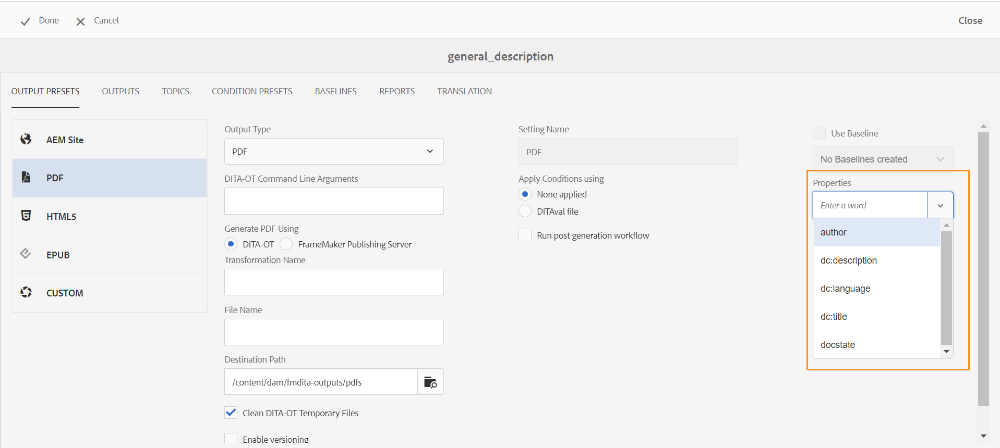
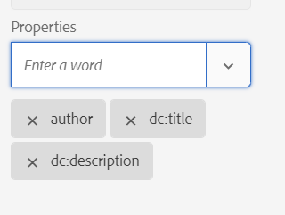

# Pasar los metadatos a la salida utilizando DITA-OT {#id21BJ00QD0XA}

Los metadatos son información adicional sobre el resultado. En AEM Guides, puede pasar los metadatos existentes o crear etiquetas de metadatos personalizadas. Puede pasar metadatos a salidas de AEM, PDF, HTML5, EPUB y de formato personalizado mediante la publicación DITA-OT.

Realice los siguientes pasos para pasar los metadatos a la salida mediante la publicación DITA-OT:

1. En la **interfaz de usuario de Assets**, vaya al archivo de mapa DITA para el que desea pasar los metadatos a DITA-OT y haga clic en él.
1. Seleccione y edite un ajuste preestablecido de salida al que desee pasar los campos de metadatos. Por ejemplo, seleccione el ajuste preestablecido de salida PDF.
1. Seleccione **DITA-OT** en la opción Generate &lt;output\> Using del ajuste preestablecido de salida seleccionado.

   {width="800"}

1. En la lista desplegable Propiedades, seleccione los metadatos que desee pasar a la publicación DITA-OT.

   La lista desplegable Propiedades enumera las propiedades personalizadas y las predeterminadas. Por ejemplo, en la captura de pantalla anterior, el autor es la propiedad personalizada, mientras que `dc:description`, `dc:language`, `dc:title` y `docstate` son las propiedades predeterminadas.

   >[!NOTE]
   >
   > Estas propiedades se seleccionan del archivo metadataList disponible en la siguiente ubicación:`/libs/fmdita/config/metadataList`. De manera predeterminada, hay cuatro propiedades enumeradas en este archivo: `dc:description`, `dc:language`, `dc:title` y `docstate`.

   Este archivo se puede superponer en: `/apps/fmdita/config/metadataList`.

   Para pasar una propiedad personalizada para la que ya ha definido los valores, consulte [Usar metadatos de AEM en la salida DITA-OT de PDF](https://experienceleaguecommunities.adobe.com/t5/xml-documentation-discussions/use-aem-metadata-in-dita-ot-pdf-output/td-p/411880).

1. En el menú desplegable **Propiedades**, seleccione las propiedades personalizadas y predeterminadas necesarias. Por ejemplo, seleccione `author`, `dc:title` y `dc:description`. Estos son los estándares `metadata/properties` que se crean una vez que creamos un archivo. Las propiedades seleccionadas se muestran debajo de la lista desplegable.

   {width="300"}

1. Haga clic en **Listo** en la parte superior izquierda para guardar los cambios.
1. Genere la salida.

Las propiedades de metadatos seleccionadas se pasarán a la salida generada mediante DITA-OT.

**Tema principal:**[ Generación de resultados](generate-output.md)
