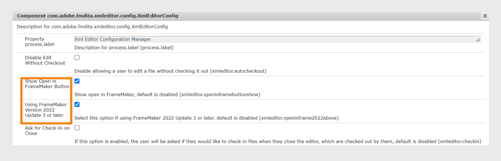

# Integración de editores XML basados en escritorio

Hay muchos editores XML disponibles en el mercado, y es posible que ya esté utilizando uno. Adobe FrameMaker es uno de los editores XML más potentes, que viene con el conector de AEM. Con el conector de AEM en FrameMaker, puede conectarse fácilmente con el repositorio de AEM, retirar y registrar archivos y editar archivos directamente en FrameMaker. También puede configurar Experience Manager Guides para iniciar FrameMaker desde el Editor. Una vez que haya abierto el archivo en FrameMaker, puede editarlo y volver a registrarlo en el repositorio de AEM.

## Habilitar la edición de archivos en FrameMaker desde el Editor

Puede utilizar FrameMaker o cualquier otro editor DITA para crear y actualizar contenido DITA. Sin embargo, si su organización utiliza FrameMaker como editor DITA, puede proporcionar a los usuarios una opción para abrir documentos DITA directamente en FrameMaker desde AEM.


De manera predeterminada, los usuarios no ven el botón **Abrir en FrameMaker** en la barra de herramientas de AEM.

Las siguientes pestañas proporcionan instrucciones para añadir este botón en la barra de herramientas de AEM en función de la configuración de Experience Manager Guides: Cloud Service o On-Premise.

>[!BEGINTABS]

>[!TAB Cloud Service]

Siga las instrucciones indicadas en [Anulaciones de configuración](download-install-config-override.md#) para crear el archivo de configuración. En el archivo de configuración, proporcione los siguientes detalles \(property\) para agregar este botón en la barra de herramientas de AEM:


| PID | Clave de propiedad | Valor de propiedad |
|---|------------|--------------|
| `com.adobe.fmdita.xmleditor.config.XmlEditorConfig` | `xmleditor.openinframebuttonshow` | Boolean \(true/false\). Si desea mostrar el botón **Abrir en FrameMaker**, establezca esta propiedad en true. <br> **Valor predeterminado**: false |


Si usa la versión 2409 y la actualización 3 de septiembre de FrameMaker 2022, debe habilitar la configuración de **FrameMaker versión 2022 actualización 3 o superior** para que los usuarios pasen los detalles del servidor de Experience Manager Guides a FrameMaker.  De forma predeterminada, está desactivada.


| PID | Clave de propiedad | Valor de propiedad |
|---|------------|--------------|
| `com.adobe.fmdita.xmleditor.config.XmlEditorConfig` | `xmleditor.openinframe2022above` | Boolean \(true/false\). Si está utilizando la actualización 3 de la versión de septiembre de 2022 de FrameMaker y, a continuación, establezca esta propiedad en true. <br> **Valor predeterminado**: false |


Cuando establece la propiedad *openinframebuttonshow* en true, se muestra el botón **Abrir en FrameMaker** al seleccionar cualquier archivo DITA en el repositorio de AEM. Si esta propiedad no se establece en *true*, el botón **Abrir en FrameMaker** solo se muestra al seleccionar un archivo .fm o .book en el repositorio

>[!TAB Local]

1. Abra la página Configuración de la consola web de Adobe Experience Manager.

   La URL predeterminada para acceder a la página de configuración es:

   ```http
   http://<server name>:<port>/system/console/configMgr
   ```

1. Busque y haga clic en el paquete **com.adobe.fmdita.xmleditor.config.XmlEditorConfig**.
   

1. Seleccione la opción **Mostrar botón Abrir en FrameMaker**.

1. Si usa la versión 4.6 y la actualización 3 de septiembre de FrameMaker 2022, debe habilitar la configuración de **FrameMaker versión 2022 actualización 3 o superior** para que los usuarios pasen los detalles del servidor de Experience Manager Guides a FrameMaker. De forma predeterminada, está desactivada.


1. Haga clic en **Guardar**.


Cuando activa la opción **Mostrar botón Abrir en FrameMaker**, se muestra el botón **Abrir en FrameMaker** al seleccionar cualquier archivo DITA en el repositorio de AEM. Si esta opción está *no habilitada*, el botón **Abrir en FrameMaker** solo se muestra al seleccionar un archivo .fm o .book en el repositorio.

>[!ENDTABS]
