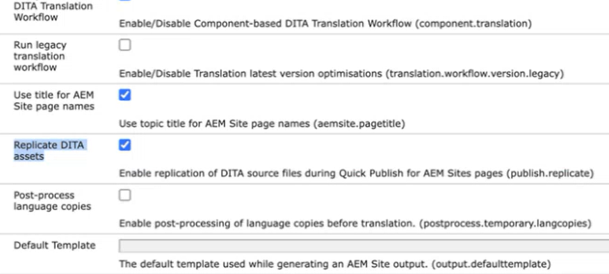

# Configuración de la replicación de recursos DITA

Siga estos pasos para configurar la función de procesamiento de recursos:

1. Abra la página Configuración de la consola web de Adobe Experience Manager.

   La URL predeterminada para acceder a la página de configuración es:

   ```http
   http://<server name>:<port>/system/console/configMgr
   ```

1. Busque y seleccione el paquete *com.adobe.fmdita.config.ConfigManager*.

1. Configure la configuración `Replicate DITA assets` según sus necesidades. La configuración está habilitada de forma predeterminada.


   {width="350"}


1. Seleccione **Guardar**.
