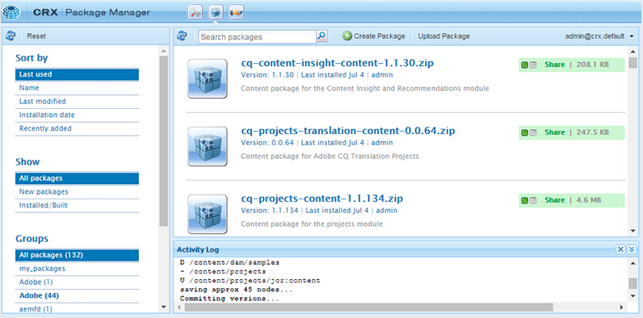

# Descargue e instale AEM Guides por primera vez {#id213BCL00KEV}

Realice los siguientes pasos para descargar e instalar AEM Guides por primera vez en un equipo:

>[!IMPORTANT]
>
> Si desea utilizar Livefyre junto con AEM Guides, asegúrese de instalar las versiones de Livefyre anteriores a la 3.0 antes de instalar AEM Guides. Si utiliza la versión 3.0 o superior de Livefyre, no existe dicha restricción.

1. Descargar AEM Guides desde [Portal de distribución de software de Adobe](https://experience.adobe.com/#/downloads/content/software-distribution/es/aem.html).

   >[!NOTE]
   >
   >Antes de instalar Experience Manager Guides, asegúrese de que su sistema cumpla [los requisitos técnicos](../install-guide/download-install-technical-requirements.md).

1. Inicie sesión en la instancia de AEM y vaya al Administrador de paquetes de CRX. La URL predeterminada para acceder al administrador de paquetes es:

   ```http
   http://<server name>:<port>/crx/packmgr/index.jsp
   ```

   El Administrador de paquetes administra los paquetes en la instalación local de AEM. Para obtener más información sobre cómo trabajar con el Administrador de paquetes, consulte [Cómo trabajar con paquetes](https://helpx.adobe.com/experience-manager/6-5/sites/administering/using/package-manager.html) en la documentación de AEM.

   {width="650"}

1. Para cargar el paquete de AEM Guides, haga clic en **Cargar paquete**.

1. En el cuadro de diálogo Cargar paquete, vaya al archivo AEM Guides que descargó en el paso 1 y haga clic en **Aceptar**.

   El paquete se carga en la instancia de AEM.

1. Para instalar el paquete, haz clic en **Instalar**.

   {width="650"}

1. En el diálogo Instalar paquete, haga clic en **Instalar**.

1. Para comenzar con AEM Guides, haga clic en el botón Inicio  en la esquina superior izquierda del Administrador de paquetes de CRX.


>[!NOTE]
>
> Realice el procedimiento de instalación en todas las instancias de servidores de AEM de la instalación.

**Tema principal:**[ Descargar e instalar](download-install.md)
