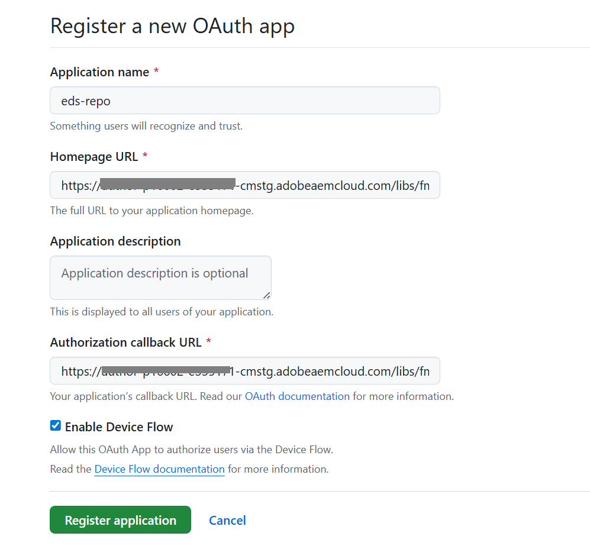
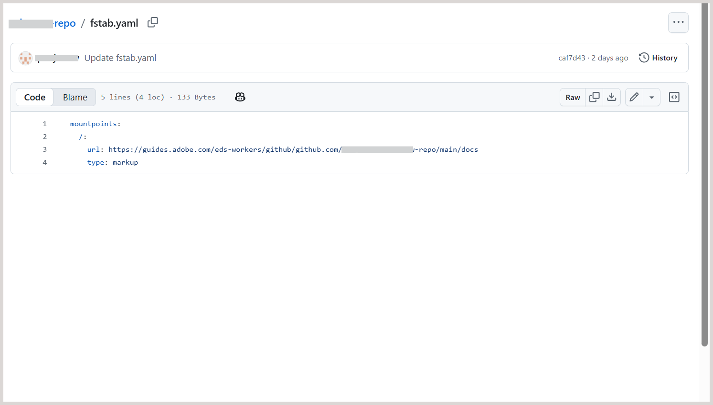
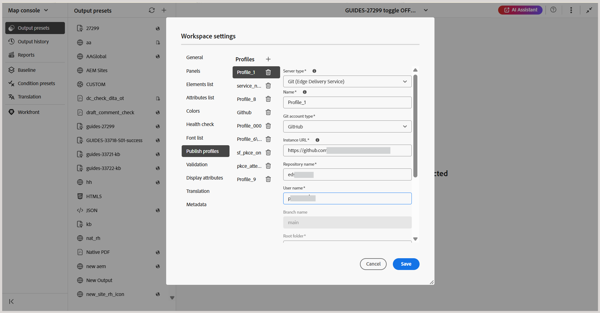
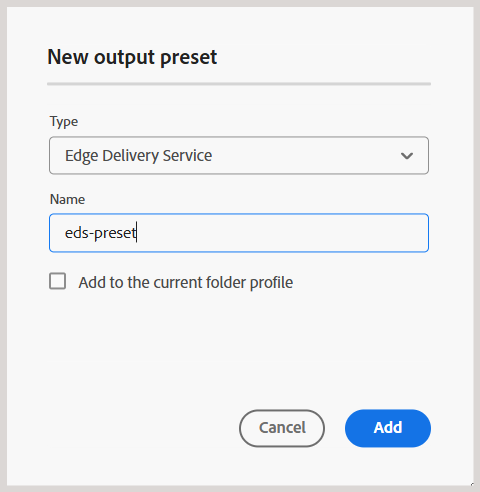

# EXPERIENCE MANAGER GUIDES y EDGE DELIVERY SERVICES

Adobe Experience Manager Guides le permite publicar el contenido DITA directamente en Edge Delivery Services (EDS) a través de un perfil de publicación basado en GitHub. Esta capacidad permite a las organizaciones ofrecer experiencias de documentación de alto rendimiento y adaptables mientras mantienen los flujos de trabajo de creación basados en DITA en Experience Manager Guides.

Para obtener más información sobre el uso de EDS en Adobe Experience Manager, vea [Información general de Edge Delivery Services](https://experienceleague.adobe.com/es/docs/experience-manager-cloud-service/content/edge-delivery/overview).

Para habilitar la publicación desde Experience Manager Guides a EDS, debe completar una serie de pasos de configuración en GitHub y Experience Manager Guides. Las secciones siguientes describen cada paso en secuencia y explican cómo funcionan juntos en el flujo de trabajo general de publicación.

1. [Configuración de GitHub para EDS](#set-up-and-configure-github-for-eds)
2. [Creación y configuración de un perfil de publicación para EDS en Experience Manager Guides](#create-and-configure-a-publish-profile-for-eds-in-experience-manager)
3. [Personalización de la salida mediante bloques EDS](#customize-output-using-eds-blocks)

Para ver un tutorial rápido en vídeo, vea [Publicación en AEM Guides](https://experienceleague.adobe.com/en/docs/experience-manager-guides/using/knowledge-base/expert-session/publishing-in-aem-guides-aug25).


## Configuración de GitHub para EDS

En esta sección se describe cómo configurar GitHub para utilizarlo con EDS. Abarca la creación de un repositorio con la plantilla de Adobe, la conexión de GitHub a Adobe Experience Manager a través de la sincronización de código de AEM, la configuración de las aplicaciones de GitHub y OAuth necesarias y la definición del punto de montaje del repositorio utilizado para publicar contenido.

### Creación de un repositorio de GitHub para EDS

EDS requiere un repositorio de GitHub con una estructura predefinida. Adobe proporciona un repositorio oficial de plantillas diseñado específicamente para los usuarios de Experience Manager Guides.

Siga estos pasos para crear su repositorio:

1. Abra el repositorio de plantillas de plantillas de plantillas de plantillas de plantillas de Experience Manager Guides [aem-guides-boilerplate](https://github.com/adobe/aem-guides-boilerplate).
   

2. Cree un nuevo repositorio con esta plantilla. Más información acerca de [Crear un repositorio a partir de una plantilla](https://docs.github.com/en/repositories/creating-and-managing-repositories/creating-a-repository-from-a-template). Asegúrese de que la visibilidad del repositorio esté establecida en *Public* para que EDS pueda acceder a ella.

   

El repositorio ahora se crea y se alinea con la estructura de plantillas de plantillas de plantillas.


### Crear una nueva aplicación de OAuth

Se requiere una aplicación OAuth para autenticar a los usuarios al crear un perfil de publicación EDS en Experience Manager Guides. Habilita un flujo de inicio de sesión seguro mediante *ID de cliente* y *Secreto de cliente*.

Siga estos pasos para crear una nueva aplicación de OAuth:

1. En GitHub, vaya a la barra lateral izquierda y seleccione **Configuración de desarrollador**.
2. En la barra lateral izquierda, seleccione **Aplicaciones OAuth**.
3. Seleccione **Nueva aplicación de OAuth**.

   {width="650"}

4. Registre la solicitud proporcionando los siguientes detalles obligatorios:

   - **Nombre de aplicación**: escriba el nombre del repositorio EDS
   - **URL de la página principal**: escriba la URL de la instancia de Experience Manager Guides. (Para ver el formato de URL de ejemplo, consulte el paso 4 de [Crear una nueva aplicación de GitHub](#create-a-new-github-app) sección).
   - **URL de devolución de llamada de autorización**: Igual que la URL de la página principal

5. Seleccione la opción **Habilitar flujo de dispositivo** y, a continuación, seleccione **Registrar aplicación** para completar el registro.

   {width="650"}

La aplicación ya está lista. Observe el *ID de cliente*. Puede generar hasta cinco *secretos de cliente* ahora o más tarde al configurar el perfil de publicación en Experience Manager Guides.


### Configuración de la URL del punto de montaje en el repositorio EDS

EDS lee contenido desde una URL de *punto de montaje* definida en el archivo `fstab.yaml` en la raíz del repositorio. Esta dirección URL apunta a EDS hasta la ubicación en la que Experience Manager Guides publica el contenido generado.

Para configurar la dirección URL del punto de montaje en el archivo `fstab.yaml`:

1. En su repositorio de GitHub, abra el archivo `fstab.yaml`.
2. Actualice el valor `url` con el siguiente formato:

   ```text
   https://guides.adobe.com/eds-workers/<account type>/<git acc domain>/<git username>/<git repo>/<branch>/<root folder>
   ```

   En la tabla siguiente se describe cada campo de la dirección URL:

   | Campo | Descripción |
   |---|---|
   | `https://guides.adobe.com/eds-workers` | URL de trabajo utilizada por Experience Manager Guides para publicar contenido en EDS. No cambie este valor. |
   | `<account type>` | Tipo de cuenta de Git. Establecido en `github`. |
   | `<git acc domain>` | Dominio de su cuenta de Git. Establecido en `github.com`. |
   | `<git username>` | Su nombre de usuario de GitHub. |
   | `<git repo>` | Nombre del repositorio de GitHub que ha creado para EDS. |
   | `<branch>` | Rama en la que desea publicar el contenido. El valor predeterminado es `main`. Si cambia el nombre de la rama en GitHub, actualícela aquí y en el perfil de publicación de EDS en Experience Manager Guides. |
   | `<root folder>` | Carpeta raíz del repositorio donde se confirman los archivos publicados. El valor predeterminado es `docs`. Si cambia el nombre de la carpeta en GitHub, actualícela aquí y en el perfil de publicación de EDS en Experience Manager Guides. |

   Por ejemplo, si el nombre de usuario de GitHub es `my-username` y el nombre del repositorio es `my-eds-repo`, el archivo `fstab.yaml` aparece de la siguiente manera:

   ```yaml
   mountpoints:
     /:
       url: https://guides.adobe.com/eds-workers/github/github.com/my-username/my-eds-repo/main/docs
       type: markup
   ```

   {width="650"}

   >[!NOTE]
   >
   > Si sigue utilizando el formato de dirección URL anterior (`https://guides.adobe.com/eds-workers/<git username>/<git repo>/<branch>/<root folder>`), el tipo de cuenta y el dominio predeterminados son `github` y `github.com`.

3. Repita los pasos 2 y 3 de [Conecte GitHub a Adobe a través de la sección AEM Code Sync](#connect-github-to-adobe-via-aem-code-sync) para autorizar el repositorio.

### Conectar GitHub a Adobe mediante la sincronización de código de AEM

Adobe Experience Manager usa una aplicación de GitHub llamada **AEM Code Sync** para insertar contenido de Experience Manager Guides en GitHub.

Realice los siguientes pasos para instalar y configurar la aplicación *AEM Code Sync*:

1. Vaya a la página [Sincronización de código AEM](https://github.com/apps/aem-code-sync) y seleccione **Instalar**.

   **AEM Code Sync** supervisa los cambios en el repositorio y garantiza que las actualizaciones se inserten correctamente en GitHub.

   >[!NOTE]
   >
   >Al instalar la aplicación, asegúrese de utilizar la misma cuenta de GitHub que posee el repositorio.

   

2. En la página siguiente, conceda acceso al repositorio que ha creado. Seleccione **Seleccionar solo repositorios** y, a continuación, seleccione su repositorio en la lista desplegable.

   {width="350"}

3. Seleccione **Instalar y autorizar**.

   Se le redirigirá a la página de configuración de GitHub.

   

4. Revise los detalles del código fuente y seleccione **Siguiente**.

5. En la página **Origen del contenido**, configure las siguientes opciones:

   - **Tipo de origen de contenido:** Seleccione **Otro (traiga su propio marcado)**.
   - **URL de origen de contenido:** Revise la URL configurada como URL de punto de montaje en el archivo `fstab.yaml`. Si no ha actualizado la dirección URL del archivo, puede actualizarla aquí.
   - **Extensión de archivo:** Cambie el sufijo predeterminado `.html` a `.htm`.

   Asegúrese de que **Usar un origen de contenido diferente** está seleccionado.

6. En la página **Usuarios**, agregue usuarios si es necesario y seleccione **Siguiente**.

7. Revise el resumen de la configuración y seleccione **Guardar**.

   Después de registrarse correctamente, aparece una página de confirmación. Puede copiar y guardar las direcciones URL **Vista previa** y **Activo** de su sitio web desde esta página.

   

## Configuración de GitLab para EDS

Para obtener instrucciones sobre cómo configurar GitLab como repositorio de publicación para Edge Delivery Services, consulte [Configurar GitLab para EDS](./configure-eds-gitlab.md).

## Creación y configuración de un perfil de publicación para EDS en Experience Manager

Las secciones siguientes describen cada paso en secuencia y explican cómo configurar el perfil de publicación de EDS, configurar un ajuste preestablecido de salida y generar resultados mediante EDS en Experience Manager Guides.

### Creación del perfil de publicación de EDS para GitHub o GitLab

1. Vaya a **[Configuración de Workspace](/help/product-guide/cs-install-guide/workspace-settings.md)** **>** **Publicar perfiles**.
2. Seleccione el icono **+** para crear un nuevo perfil de publicación y proporcione los siguientes detalles:

   - **Tipo de servidor\*:** Seleccione **Git (servicio de Edge Delivery)** en el menú desplegable.
   - **Nombre\*:** Escriba un nombre para el perfil de publicación.
   - **Tipo de cuenta Git\*:** Seleccione **GitHub** o **GitLab** del menú desplegable, según el proveedor del repositorio Git.
   - **URL de instancia\*:** Escriba la URL de su instancia de GitHub o GitLab, por ejemplo, `https://github.com` o `https://gitlab.com`.
   - **Nombre del repositorio\*:** Escriba el nombre de su repositorio de GitHub o GitLab.
   - **Nombre de usuario\*:** Escriba su nombre de usuario de GitHub o GitLab.
   - **Nombre de la rama:** Establecido en `main` (predeterminado).
   - **Carpeta raíz\*:** establecida en `docs` (predeterminada).
   - **Propietario del sitio (*Solo GitLab*):** Escriba el propietario del sitio de Edge Delivery Services.
   - **Repositorio de sitios (*Solo GitLab*):** Escriba el nombre del repositorio asociado con el sitio de Edge Delivery Services.
   - **Clave de API HLX:** Escriba la clave de API HLX para la configuración de EDS. Esta clave es necesaria para admitir la función Publicación cancelada introducida en la versión 2026.11.0 de Experience Manager Guides as a Cloud Service. Además, la clave es necesaria para publicar el contenido en EDS si el tamaño del contenido es de más de 100 archivos.
   - **Credenciales de autenticación:** Proporcione las credenciales según el tipo de cuenta de Git seleccionada:
     - **GitHub:** Escriba el **ID de cliente\*** y el **secreto de cliente\*** obtenido de su aplicación OAuth de GitHub. Consulte [Crear una nueva aplicación de OAuth](#create-a-new-oauth-app) para obtener más información.
     - **GitLab:** Escriba el **token de acceso\*** generado para su cuenta de GitLab.
3. (*Solo GitHub*) Seleccione **Iniciar sesión** para autenticarse. Para GitLab, no se requiere inicio de sesión porque el token de acceso se utiliza para la autenticación.

   {width="650"}

4. Seleccione **Guardar**. Para GitHub, la opción **Guardar** está disponible después de la autenticación correcta.

El perfil de publicación de EDS ya está configurado.

### Cree un ajuste preestablecido de salida para EDS y genere la salida

1. Abra el mapa en la consola Mapa.
2. En la pestaña **Ajustes preestablecidos de salida**, seleccione **+** para crear un nuevo ajuste preestablecido de salida.
3. En el cuadro de diálogo **Nuevo ajuste preestablecido de salida**, proporcione los siguientes detalles:
   - **Tipo**: Seleccione **Servicio Edge Delivery**
   - **Nombre**: proporcione un nombre para este ajuste preestablecido
4. Seleccione **Añadir**.

   {width="650"}
5. Abra el ajuste preestablecido de salida EDS recién creado y configure los siguientes campos:

   - **Filtro condicional:** Seleccione **Ninguno** para generar resultados sin filtrar o **Usar DITAVAL** para aplicar el filtrado condicional.
   - **Publicar subcarpeta:** Escriba el nombre de la subcarpeta en la que se publica el resultado. La subcarpeta se crea en el repositorio bajo la carpeta raíz y su nombre aparece en los vínculos EDS al contenido publicado. Por ejemplo, si la carpeta raíz es `docs` y la subcarpeta de publicación es `product-guide`, el contenido se publica en `docs/contents/product-guide`.
   - **Perfil de publicación:** Seleccione el perfil de publicación de GitHub o GitLab configurado en la sección anterior.

     {width="650"}

6. Seleccione **Guardar** y, a continuación, **Generar salida**.

>[!NOTE]
>
>La salida generada se almacena en la carpeta `<root folder>/contents/<publish subfolder>` del repositorio EDS.

La salida EDS ahora se genera. El contenido se presenta en un diseño limpio y adaptable. Incluye elementos regulares como el título de la página, las rutas de exploración, el contenido del cuerpo y cualquier bloque utilizado en el tema. El índice de la izquierda (generado a partir del mapa) le ayuda a desplazarse por los temas, mientras que un mini índice de la derecha resalta las secciones de la página actual. Toda la salida es totalmente adaptable, lo que garantiza una experiencia de lectura optimizada y coherente en todos los dispositivos.

>[!NOTE]
>
> Es posible publicar varias asignaciones DITA en el mismo sitio Web. Los mapas publicados aparecen en el panel de navegación izquierdo, lo que permite a los usuarios acceder al contenido de cada mapa. La publicación de una nueva asignación no sobrescribe las asignaciones publicadas anteriormente.


## Personalización de la salida mediante bloques EDS

EDS usa `blocks` para controlar cómo se diseñan y muestran las diferentes partes del contenido. Puede modificar bloques existentes o crear bloques personalizados.

Los ejemplos descritos a continuación le guían a través de la personalización de un bloque existente y la creación de un nuevo bloque para aplicar estilo a la salida EDS final en Experience Manager Guides.

### Personalización de un bloque de ruta de exploración para actualizar el color del texto

Las rutas de exploración se utilizan en todas las páginas para ayudar a los usuarios a comprender dónde se encuentran en la documentación. Dado que este bloque aparece de forma coherente en todo el sitio web, la actualización de su estilo permite una actualización de diseño unificada.

Siga estos pasos para personalizar un bloque de ruta de exploración y actualizar su color de texto:

1. Vaya al repositorio de GitHub y abra la carpeta `blocks`.
2. Seleccione el bloque **rutas**.

   {width="650"}
3. Abra el archivo `css` y actualice el color del texto.
4. Confirme los cambios en GitHub.
5. Actualice el sitio web activo para ver las actualizaciones.

### Actualizar scripts EDS para crear elementos personalizados en la salida publicada

En algunos casos, es posible que solo desee aplicar estilo a una parte específica del contenido. Realice los siguientes pasos para conseguirlo utilizando un bloque personalizado.

1. Abra el archivo de tema y seleccione el texto dentro de un elemento de etiqueta.

   En la siguiente captura de pantalla, se selecciona el contenido dentro de la etiqueta `example`.
   {width="650"}
2. Para configurar el texto dentro de la etiqueta `example`:
   - Vaya a **Propiedades de contenido**.
   - Agregue el atributo `outputclass`.
   - Establezca su valor en `example eds-force-block`.
   - Seleccione **Añadir**.
     {width="650"}
3. Guarde y vuelva a generar la salida.
4. Cree una nueva carpeta con el mismo nombre que `outputclass` dentro del directorio `blocks`. Obtenga información acerca de [agregar archivos a un repositorio](https://docs.github.com/en/repositories/working-with-files/managing-files/adding-a-file-to-a-repository#adding-a-file-to-a-repository-using-the-command-line).

   {width="650"}

5. Agregue los `css` necesarios y los `js` archivos opcionales.

   {width="650"}

6. Confirme los cambios y vuelva a generar la salida.

El contenido seleccionado ahora muestra el estilo personalizado definido en el bloque.

{width="650"}
