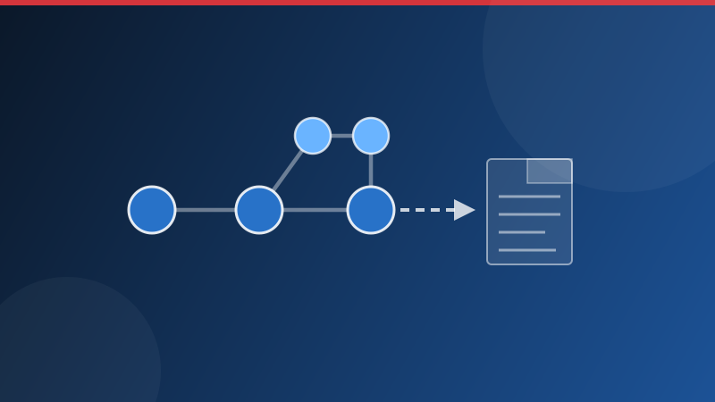
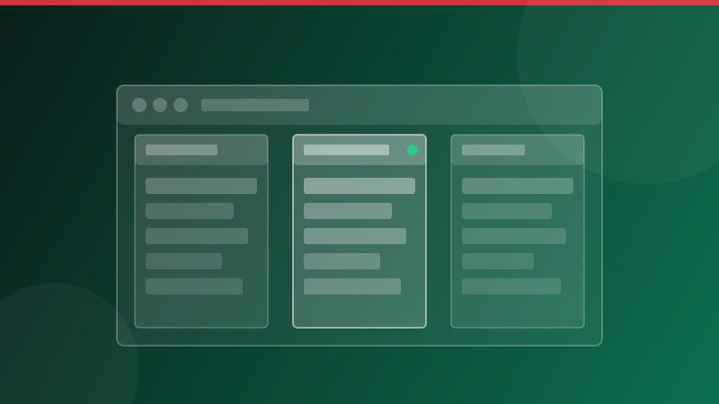

# Documentación de Experience Manager Guides

Experience Manager Guides es un CCMS de nivel empresarial compatible con DITA nativo para la creación estructurada, la publicación multicanal y la administración del ciclo de vida de contenido.

**Implementación:** [!BADGE Cloud Service]{type=Positive} [!BADGE Local]{type=Informative}

## Comience por su función

::::landing-cards-container
:::card

Administradores

Configure perfiles de carpeta, permisos, configuración de flujo de trabajo y plantillas de salida.

[Guía de administración](./install-conf-guide/introduction.md)
:::

:::card

Autores

Cree y administre temas, mapas, reutilización de contenido y flujos de trabajo de revisión de DITA.

[Información general sobre la creación](./user-guide/authoring-content.md)
:::

:::card

Editores

Configure ajustes preestablecidos de salida, administre líneas de base y genere resultados en todos los canales.

[Administración y publicación de mapas](./user-guide/map-console-overview.md)
:::

::::

<!--
:::card

Architects

Design DITA specializations, schemas, and content architecture for your implementation.

[DITA specialization](./install-conf-guide/dita-ot-specialization.md)
:::

::::
-->

## Explorar por área de funcionalidad

<!-- Author note: Six cards wrap to two rows of three in production. The landing-cards-container component is in beta — verify rendering in production before publishing. -->

::::landing-cards-container

:::card

Creación

Cree y edite contenido estructurado mediante las funciones de creación de Editor y DITA.

[Creación del contenido](./user-guide/web-editor.md)
:::

:::card

Asistente de IA

Acelere la creación de contenido, encuentre respuestas y aplique etiquetas inteligentes con asistencia basada en IA.

[Asistente de IA](./user-guide/ai-assistant.md)
:::

:::card

Revisión

Cree y administre tareas de revisión, colabore en los comentarios y solucione los comentarios de revisión.

[Introducción a la revisión](./user-guide/review.md)
:::

:::card

Publicación

Configure y genere resultados en AEM Sites, PDF, HTML5, EPUB, JSON y otros formatos.

[Publicación del contenido](./user-guide/generate-output.md)
:::

:::card

Traducción

Traducir contenido mediante flujos de trabajo de traducción humana o automática y rastrear el estado de traducción.

[Traducir contenido](./user-guide/translation.md)
:::

:::card

Informes

Evalúe el estado del contenido, administre metadatos, identifique vínculos rotos y analice la reutilización del contenido.

[Generación de informes](./user-guide/reports-intro.md)
:::

::::

## Recursos y actualizaciones

>[!BEGINSHADEBOX]

<table>
<tr style="border: 0;">
<td>

**Novedades de AEM Guides**

Explore las nuevas y mejoradas funciones de la última versión de Experience Manager Guides, 2026.11.0.

- Bifurcación y combinación a nivel de mapa
- Creación e importación de contenido en el asistente de IA
- Nuevo panel Asistente de ayuda

[Explorar todo](../../help/product-guide/release-info/whats-new-2026-11-0.md)

</td>
<td>

**Notas de la versión**

Explore las últimas notas de la versión y las actualizaciones de productos para las implementaciones en la nube y locales.

- Versiones en la nube | [Ver notas de la versión](./release-info/latest-release-info-cs.md)
- Versiones On-Premise | [Ver notas de la versión](./release-info/latest-release-info.md)

[Ver hoja de ruta de versiones](./release-info/aem-guides-releases-roadmap.md)

</td>
<td>

**Información y asistencia**

Acceda a recursos útiles, documentación y asistencia para sacar el máximo partido a la plataforma.

* [Repositorio de GitHub](https://github.com/AdobeDocs/experience-manager-guides.en){target="_blank"}
* [Soporte](https://experienceleague.adobe.com/support/v2/en/){target="_blank"}
* [Tutoriales en vídeo](https://experienceleague.adobe.com/en/docs/experience-manager-guides-learn/videos/getting-started/overview){target="_blank"}
* [comunidad de AEM Guides](https://experienceleaguecommunities.adobe.com/adobe-experience-manager-guides-11){target="_blank"}

</td>
</tr>
</table>

>[!ENDSHADEBOX]

