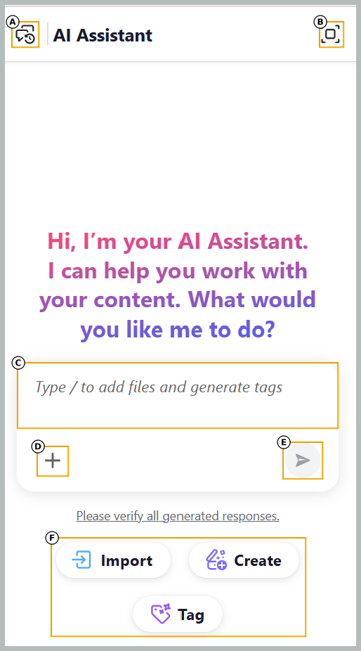

# Asistente de IA

>[!NOTE]
>
> Actualmente, la función AI Assistant está disponible para Adobe Experience Manager Guides as a Cloud Service.

El asistente de IA de Adobe Experience Manager Guides es una herramienta con tecnología de IA diseñada para mejorar la productividad mediante la simplificación de los flujos de trabajo de creación, administración y creación de contenido. Ofrece dos modos: Agentic y Standard. En **modo agente**, el Asistente de IA le permite realizar tareas relacionadas con el contenido mediante interacciones en lenguaje natural, con habilidades como Importar, Crear y Etiquetado inteligente para optimizar la creación de contenido, la organización y la administración de metadatos. En **modo estándar**, el Asistente de IA proporciona asistencia para la creación, lo que le ayuda a crear, refinar y administrar contenido de manera más eficiente.

## Modos de asistente de IA

El Asistente de IA está disponible en dos modos: **Agentic** y **Standard**. Los administradores pueden seleccionar el modo en la sección **características de IA** de la ficha **General** en la **configuración de Workspace**. El panel Asistente de IA del Editor sigue siendo el mismo en ambos modos, pero las capacidades disponibles difieren:

- **Modo agente:** Utiliza las habilidades **Importar**, **Crear** y **Etiquetado inteligente** para convertir archivos en temas estructurados, crear el primer borrador de contenido y recomendar etiquetas relevantes basadas en la taxonomía de su organización.
- **Modo estándar:** proporciona asistencia para la creación basada en IA a través de acciones contextuales, como reutilización de contenido, traducción y mejoras de calidad de contenido, para optimizar los flujos de trabajo de creación.

## Modo agéntico

>[!NOTE]
>
> Para utilizar el asistente de IA en modo automático, su organización debe estar integrada en Adobe CX Enterprise Coworker y tener créditos disponibles; una vez integrada, póngase en contacto con el equipo de éxito del cliente para habilitar la función. Para obtener detalles de configuración, vea [Configurar el Asistente de IA en modo agente](../install-conf-guide/configure-ai-assistant-agentic-mode-cs.md).

El modo agente del Asistente de IA le permite realizar una amplia gama de tareas relacionadas con el contenido mediante interacciones en lenguaje natural, como crear e importar contenido, resumir temas, agregar temas a mapas y administrar metadatos. Puede describir sus necesidades en el panel de chat, y el asistente de IA planea y ejecuta tareas mientras proporciona visibilidad sobre su progreso. El modo agéntico proporciona un acceso rápido a las siguientes habilidades:

- **Importar**: Convierte los archivos de PDF, Word o Markdown de su dispositivo o repositorio de contenido en temas estructurados. Para obtener más información, vea [Importar contenido con el Asistente para IA](./import-ai-assistant.md).

- **Crear**: genera temas de borrador y mapas a partir de materiales de entrada como especificaciones, imágenes de pizarra, capturas de pantalla y otro contenido de referencia, con la opción de usar contenido existente para el tono y el estilo. Para obtener más información, vea [Crear contenido con el Asistente de IA](./create-ai-assistant.md).

- **Etiquetado inteligente**: recomienda etiquetas relevantes para los temas basados en la taxonomía de su organización para mejorar la coherencia de los metadatos. Para obtener más información, vea [Etiquetado inteligente con el asistente de IA](./ai-assistant-agentic.md).

Los siguientes componentes del panel del Ayudante de IA le ayudan a agregar contenido, introducir indicadores e iniciar tareas:

- **(A)** Historial de conversaciones: vea y vuelva a abrir conversaciones anteriores para revisar solicitudes y respuestas anteriores.
- **(B)** Pantalla completa: Amplía el panel del Asistente de IA a pantalla completa.
- **(C)** Espacio de solicitud: Escriba una solicitud de solicitud o escriba `/` para agregar archivos y generar etiquetas.
- **(D)** Adjuntar archivos o agregar contexto: Agrega temas, asignaciones o archivos del sistema local para proporcionar el contenido con el que trabaja el Ayudante de IA.
- **(E)** Enviar: Envíe el mensaje y el contenido adjunto al Ayudante de inteligencia artificial.
- **(F)** Acciones rápidas: inicia una tarea directamente desde uno de los siguientes accesos directos: **Importar**, **Crear** o **Etiqueta**.

## Modo estándar

El modo estándar hace que su proceso de creación sea más inteligente y rápido. Al seleccionar texto en el Editor, el Asistente de IA ofrece acciones rápidas, como generar sugerencias inteligentes para la reutilización de contenido, traducir contenido, mejorar la calidad del contenido y mucho más, todo en función del contenido seleccionado. Esto mejora la experiencia general de creación y la productividad de los autores.

Para obtener más información, vea [Documentos de autor con el asistente de IA](./ai-assistant-right-panel.md).

## Introducción al Asistente de IA

Cuando use **AI Assistant** por primera vez, se le pedirá que envíe su consentimiento antes de usar las funciones de Experience Manager Guides Generative AI.

Siga estos pasos para iniciar el asistente de IA:

1. Inicie sesión en Experience Manager Guides.
1. En la página de inicio, seleccione **Ayudante de IA** en la parte superior. Asegúrese de que su administrador haya activado la función Asistente de IA en el modo deseado.

El Asistente de IA muestra las características clave, el vínculo de las directrices del usuario y un botón **Introducción**.
Lea atentamente las directrices de usuario y, a continuación, seleccione **Introducción** para iniciar el asistente de IA.

>[!NOTE]
>
>Si ya ha aceptado las directrices para utilizar la función Ayudante de ayuda, no se le volverá a solicitar el consentimiento y puede seguir utilizando la función Ayudante de IA.

**Temas relacionados**

[Preguntas frecuentes sobre seguridad de AI Assistant](./ai-assistant-faq.md)

[Divulgaciones de IA generativa de Adobe Experience Manager Guides](./adobe-generative-ai-disclosures.md)

[Configuración del asistente de IA para la creación y la ayuda inteligentes](../cs-install-guide/conf-smart-suggestions.md)
