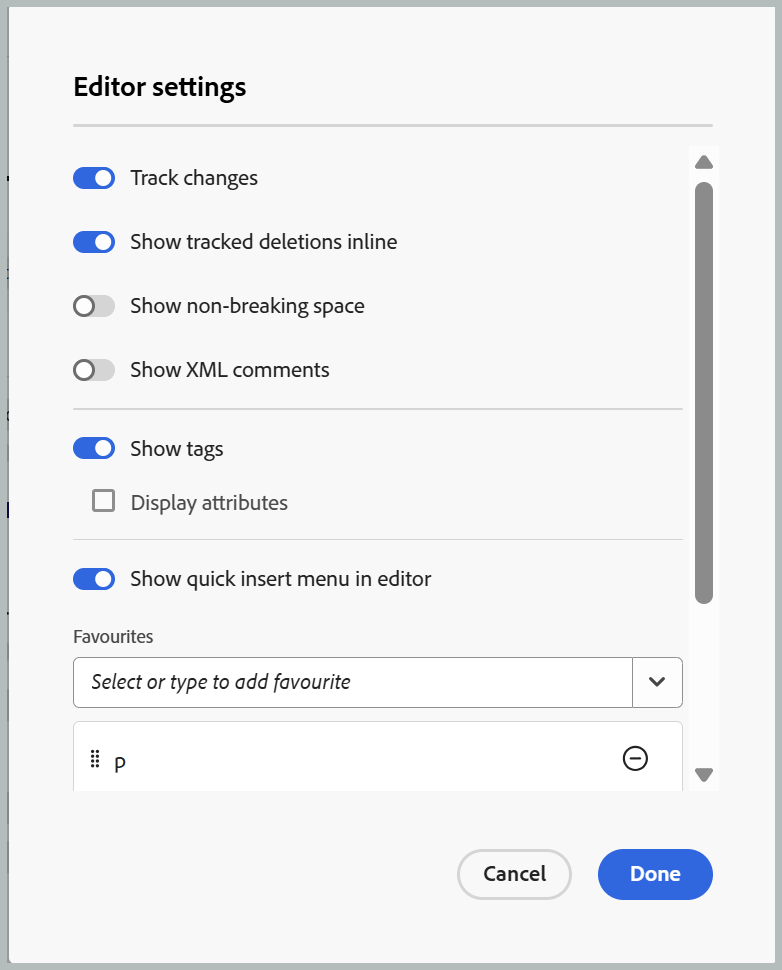
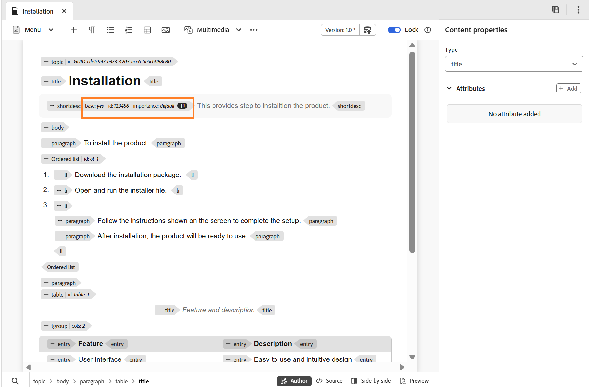
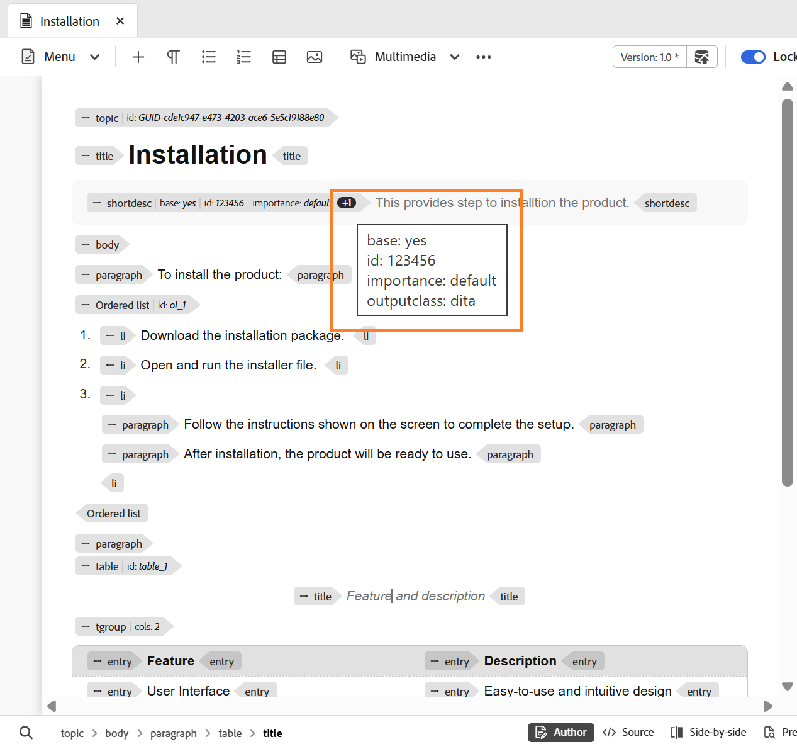

# Configuración del editor

>[!NOTE]
>
> Este artículo solo se aplica al nuevo editor. Para habilitar esta capacidad en su entorno, póngase en contacto con el equipo de éxito del cliente de AEM Guides.

La configuración del editor proporciona un panel de configuración centralizado que le permite personalizar el comportamiento del editor en un nivel de autor individual. Proporciona mayor flexibilidad, coherencia y control durante el proceso de creación.

Este panel de configuración centralizado le permite administrar las preferencias clave del editor desde una sola ubicación, lo que reduce la necesidad de realizar configuraciones dispersas o manuales. Se puede acceder a la configuración del editor desde las **más acciones** de la barra de fichas.

{width="650"}

## Opciones de configuración compatibles

La configuración del editor le permite personalizar varias opciones, como Control de cambios, Mostrar etiquetas, Menú de inserción rápida y mucho más, en función de sus preferencias.

{width="350"}

### Seguimiento de cambios

>[!NOTE]
>
>- Esta función está habilitada de forma predeterminada; para deshabilitarla, póngase en contacto con el equipo de éxito del cliente de AEM Guides.
>- Al trabajar con tablas, se realiza un seguimiento de la inserción de una fila o columna, pero no se realiza un seguimiento de la eliminación de una fila o columna en el panel Control de cambios.

Habilite el modo **Rastrear cambios** para registrar las ediciones realizadas en un tema. Una vez que está habilitado, cada inserción y eliminación se captura mientras trabaja, y todos los cambios se enumeran en el panel **Rastrear cambios**. Las ediciones consecutivas realizadas en la misma posición se agrupan y se muestran como un solo cambio en el panel **Rastrear cambios**.

El contenido eliminado aparece tachado, mientras que el contenido insertado aparece en verde. Además, las barras de cambio aparecen a lo largo del borde de la página del tema, con barras rojas que indican el contenido eliminado y barras verdes que indican el contenido agregado. Si una línea contiene adiciones y eliminaciones, se muestran ambas barras de cambios.

Cuando varios usuarios trabajan en el mismo tema, el seguimiento de cambios les permite ver las ediciones de los demás. Una vez que el contenido está listo para finalizarse, los usuarios pueden revisar las marcas de revisión y aceptarlas o rechazarlas.

{width="350"}

**Mostrar eliminaciones seguidas en línea**

Controla la forma en que se muestra el contenido eliminado en el Editor mientras la opción Rastrear cambios está activada. Cuando se habilita, el contenido eliminado permanece visible en línea, en su posición original, como texto tachado. Cuando está desactivado, no se muestra el contenido eliminado. En su lugar, aparece un icono de lápiz en la ubicación en la que se eliminó el contenido, lo que le ofrece una vista más limpia del tema. Seleccione el icono de lápiz para ir al contenido eliminado correspondiente en el panel Cambios realizados.

{width="350"}

**Aceptar o rechazar cambios realizados**

Para revisar los cambios, seleccione el icono **Rastrear cambios** en el panel derecho para abrir el panel Cambios rastreados y realice los siguientes pasos:

1. Seleccione un cambio registrado en el panel. El contenido modificado se selecciona en el documento.
1. Acepte el cambio seleccionando el icono **Aceptar cambio** o rechácelo seleccionando el icono **Rechazar cambio**.

   {width="650"}

1. Para aceptar o rechazar todos los cambios con un solo clic, seleccione **Aceptar todos los cambios** o **Rechazar todos los cambios** en la parte superior del panel.

   {width="650"}

### Espacios de no separación

Active esta opción para mostrar un indicador para los espacios de no separación al editarlo en el Editor. Solo está visible en la vista Autor para el tema DITA y los mapas DITA.

### Comentarios XML

Permite a los autores ver, editar e insertar comentarios XML directamente en el modo Autor para obtener una mejor visibilidad del contenido. Cuando está habilitada, los autores pueden ver, insertar, editar y eliminar comentarios XML directamente dentro del contenido en el propio modo Autor, lo que facilita la adición de notas contextuales para los colaboradores. Cuando están desactivados, los comentarios XML se ocultan en el modo Autor y no se pueden insertar ni modificar desde el modo Autor, lo que garantiza una experiencia de creación más limpia para los usuarios que no los necesitan. Puede seguir viendo y creando comentarios XML en el modo de código fuente utilizando la sintaxis `<!-- test comment -->`.

>[!NOTE]
>
> Para los comentarios XML, **Rastrear cambios** registra solamente la inserción o eliminación del comentario completo. Las ediciones realizadas dentro de un comentario XML existente no se registran.

{width="650"}

### Etiquetas

Controla la visibilidad de las etiquetas en el editor. Cuando está activada, las etiquetas estructurales se muestran dentro del contenido, lo que permite a los autores ver y gestionar la estructura DITA subyacente. Cuando están desactivadas, estas etiquetas se ocultan para proporcionar una experiencia de creación más limpia y centrada.

{width="650"}

Cuando la configuración de **Mostrar etiquetas** está habilitada, también puede habilitar **Mostrar atributos** para ver y validar los atributos asociados con un elemento. Cuando un elemento tiene más de tres atributos asociados a él, aparece un indicador de recuento. Al pasar el ratón por encima del indicador, se muestra la lista completa de atributos aplicados a ese elemento.

     {width=&quot;650&quot;}

### Menú de inserción rápida en el editor

Permite añadir elementos directamente mientras se edita en el modo Autor en la posición del cursor sin navegar a la barra de herramientas. Los elementos usados con frecuencia también se pueden configurar en **Favoritos** para obtener acceso más rápido. El menú de inserción rápida está disponible directamente en el Editor cuando se pulsa **Control + /** en Windows o **Comando + /** en macOS en la posición del cursor.

{width="650"}

Puede buscar y agregar elementos a Favoritos, quitar los elementos agregados anteriormente y reorganizarlos con solo arrastrar y soltar. Los favoritos incluyen los elementos utilizados con más frecuencia y el orden establecido aquí se refleja en el menú Inserción rápida cuando se accede a él desde el editor.

Aquí tiene un breve vídeo sobre cómo trabajar con el menú de inserción rápida en el nuevo editor.

>[!VIDEO](https://video.tv.adobe.com/v/3491343)

