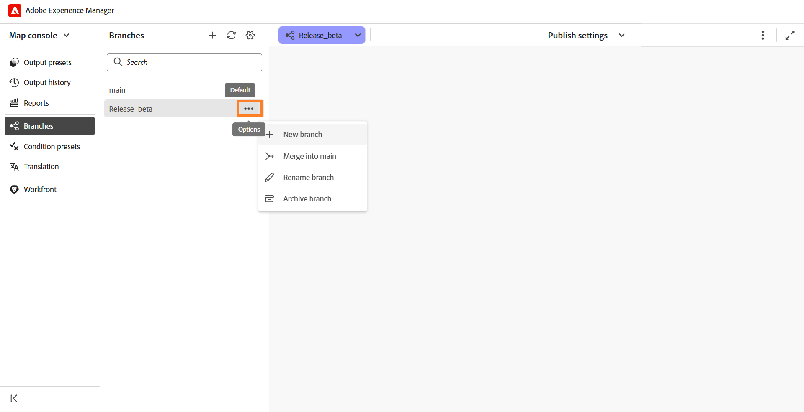

# Creación y administración de ramas de un mapa DITA

En Experience Manager Guides, se pueden crear varias ramas de un mapa DITA para administrar la documentación de distintas versiones, funciones o correcciones. Puede cambiar entre ramas para trabajar en el contenido asociado, archivar las ramas que ya no sean necesarias y restaurarlas cuando sea necesario.

También se puede crear una rama a partir de cualquier rama existente del mismo mapa DITA.

## Crear una rama

Se puede crear una rama de un mapa DITA para trabajar en los cambios de documentación sin afectar al contenido correspondiente en otras ramas.

Siga estos pasos para crear una rama:

1. Abra el mapa DITA para el que desee crear una rama.

   >[!NOTE]
   >
   > Si ya hay otro mapa abierto en el Editor, aparece un cuadro de diálogo de confirmación. Seleccione **Abrir** para abrir el mapa seleccionado en la rama actual. Para obtener más información, vea [Abrir contenido fuera del contexto actual del mapa](#open-content-outside-the-current-map-context).

1. Seleccione el menú desplegable de la rama **main** y verifique que esté seleccionado el mapa DITA requerido.

   

1. Seleccione **Nueva rama** para crear una rama del mapa seleccionado.

1. En el cuadro de diálogo **Nueva rama**, escriba un nombre para la nueva rama y seleccione la rama principal desde la que desea crearla.

   

1. Seleccione **Crear**.

Se crea una rama nueva para el mapa DITA seleccionado. Ahora puede cambiar a la nueva rama y comenzar a trabajar en el contenido asociado.

## Cambiar entre las ramas

Siga estos pasos para cambiar de rama:

1. Seleccione la **lista desplegable de ramas** en la parte superior del editor (que muestra `main` de forma predeterminada). Se mostrará la lista de ramas disponibles para el mapa DITA seleccionado.
1. Seleccione la rama con la que desee trabajar.

   

   Se abrirá la rama seleccionada, cuyo nombre aparecerá en la lista desplegable de ramas de la parte superior del Editor y reemplazará a **main**.

   

Ahora puede trabajar en el mapa y su contenido asociado dentro de la rama seleccionada.

>[!NOTE]
>
>Si un tema tiene cambios sin guardar al cambiar de rama, aparece un cuadro de diálogo que le pide que guarde los cambios antes de cambiar a la rama seleccionada.

Ahora puede trabajar en el mapa y su contenido asociado dentro de la rama seleccionada.

## Edición aislada en una rama

Cuando se trabaja en una rama de un mapa DITA, los cambios realizados en el contenido permanecen dentro de la rama seleccionada y no afectan al contenido correspondiente en otras ramas. Esto permite que varios autores trabajen en los mismos temas de forma independiente en diferentes ramas de un mapa.

De manera predeterminada, los temas no modificados se leen desde la rama de origen o `main`. Cuando edita un tema en la rama seleccionada, pasa a formar parte de esa rama. Cualquier cambio posterior en el tema permanecerá dentro de la rama seleccionada.

Puede cambiar entre ramas del mismo mapa DITA para ver y editar su contenido respectivo.

### Editar temas dentro de una rama

Se pueden editar temas asociados a un mapa DITA en la rama seleccionada sin que ello afecte a su contenido en otras ramas.

Siga estos pasos para editar un tema:

1. Abra el mapa DITA en el Editor.
2. En el menú desplegable de ramas, seleccione la rama en la que desea editar el tema.
3. Abra el tema que desee modificar desde el mapa.
4. Realice los cambios necesarios en el tema.
5. Guarde los cambios.

   Se guardará una copia del tema modificado en la rama seleccionada. El tema correspondiente de otras ramas permanece sin cambios.

Puede seguir editando el tema en la rama seleccionada o cambiar a otra rama para trabajar en su contenido.

### Abrir un mapa fuera del contexto actual del mapa

En Experience Manager Guides, **contexto de asignación** hace referencia al mapa DITA abierto actualmente en el Editor.

Si intenta abrir un mapa, tema o recurso que no forma parte del contexto actual del mapa, aparecerá un cuadro de diálogo de confirmación con las siguientes opciones:

- **Abrir:** Reemplaza el contexto actual del mapa con el contenido seleccionado.
- **Abrir en el editor:** Abre el contenido en una nueva pestaña sin cambiar el contexto actual del mapa.
- **Cancelar:** Cancela la operación y conserva el contexto de asignación actual.

Por ejemplo, considere que `master_map.ditamap` está actualmente seleccionado en la rama **principal**.

Si intenta abrir otro mapa DITA, aparecerá el siguiente cuadro de diálogo de confirmación:

Seleccione **Abrir** para cambiar al mapa seleccionado.

El contexto del mapa de la rama `main` se actualiza al mapa recién seleccionado, lo que le permite trabajar con su contenido asociado.

### Abrir o editar temas fuera del contexto de asignación actual

Los temas a los que no se hace referencia en el mapa no están disponibles automáticamente en la rama.

Seleccione **Editar en la rama actual** para que estos temas estén disponibles para su edición en la rama seleccionada.

Ahora puede editar el tema sin afectar su contenido en `main`. Sin embargo, el tema no se añade automáticamente al mapa DITA asociado y no se incluye en la salida publicada. Para incluir el tema en la salida, añádalo al mapa DITA.

## Administrar ramas

Puede administrar ramas de un mapa DITA desde el panel **Ramas** de la consola Mapa. Puede ver las ramas disponibles, crear ramas nuevas, combinar o cambiar el nombre de las existentes y archivar las ramas que ya no se utilizan de forma activa.

El panel **Ramas** enumera todas las ramas disponibles para el mapa DITA seleccionado.

Para administrar una rama, pase el ratón sobre la rama requerida y seleccione el menú **Opciones**. Estas son las acciones disponibles:

- **Nueva rama:** Cree una nueva rama a partir de la rama seleccionada.
- **Combinar en principal:** [Combinar cambios](./merge-branches.md) de la rama seleccionada en la rama `main`.
- **Cambiar nombre de rama:** Cambiar el nombre de la rama seleccionada.
- **Historial de combinación:** Muestra un historial de actividades de combinación. Esta opción solo está disponible después de crear una solicitud de combinación.
- **Archivar rama:** Archive una rama que ya no se esté utilizando de forma activa.

  >[!NOTE]
  >
  > Experience Manager Guides no admite la eliminación de ramas. Puede archivar las ramas que ya no se utilizan de forma activa.

También puede usar las opciones de la parte superior del panel **Ramas** para buscar una rama, actualizar la lista de ramas o crear una nueva.

### Archivar una rama

Puede archivar ramas de un mapa DITA que ya no se utilicen de forma activa y restaurarlas cuando sea necesario.

>[!NOTE]
>
> No se puede archivar la rama predeterminada (`main`).

Para archivar una rama, realice los siguientes pasos:

1. En el panel **Ramas**, seleccione el icono **Administrar**.

   

   Se muestra el cuadro de diálogo **Administrar ramas**.

   

   El cuadro de diálogo contiene las siguientes pestañas:

   - **Activo:** Muestra todas las ramas activas del mapa DITA seleccionado.
   - **Archivado:** enumera todas las ramas archivadas del mapa DITA seleccionado.

2. En la ficha **Activo**, pase el ratón sobre la rama que quiera archivar y seleccione **Archivar**.

   

   La rama seleccionada se archiva y se mueve a la ficha **Archivado**.

### Restaurar una rama archivada

Se puede restaurar una rama archivada de un mapa DITA cuando sea necesario reanudar el trabajo en su contenido.

Para restaurar una rama archivada, realice los siguientes pasos:

1. En el panel **Ramas**, seleccione el icono **Administrar**.
2. En el cuadro de diálogo **Administrar ramas**, seleccione la pestaña **Archivado**.
3. Busque la rama que desea restaurar y seleccione **Restaurar**.

   La rama se restaurará y aparecerá en la ficha **Activo**.

