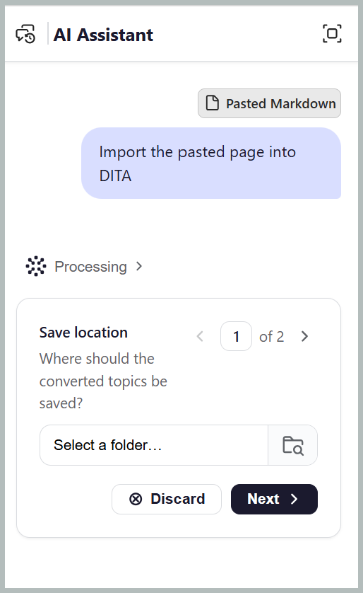

# Importación de contenido con el asistente de IA

La habilidad **Import** en el modo Agentic del Asistente de IA le ayuda a convertir archivos existentes de PDF, Word o Markdown en temas DITA estructurados, con la opción de generar mapas DITA basados en los datos introducidos por el usuario. Simplifica la ingesta de contenido de formatos no estructurados a estructurados en Adobe Experience Manager Guides al reducir el esfuerzo manual necesario para recrear, estructurar y organizar el contenido.

## Importar un archivo

Puede importar archivos desde su dispositivo o repositorio de contenido, especificar el nivel de encabezado que define el inicio de un nuevo tema y elegir la carpeta de destino para el contenido importado. Para importar un archivo, siga estos pasos:

1. Inicie sesión en Experience Manager Guides.
1. En la página de inicio, seleccione **Ayudante de IA** en la barra de navegación. Asegúrese de que el administrador habilite el [Asistente de IA en modo automático](../install-conf-guide/workspace-settings.md).
1. Seleccione **Importar** en el panel Asistente de IA. También puede usar otros indicadores como *Convertir este documento en temas DITA* para un archivo de Word o *Convertir esta marca en temas DITA* para un archivo Markdown.

   El mensaje de inicio *Ayúdeme a importar contenido del archivo PDF adjunto* aparece en el cuadro del mensaje.

1. Adjunte el archivo a la solicitud utilizando cualquiera de los siguientes métodos:

   - **Usando acceso directo**: escriba `/` en el campo Preguntar y, a continuación, elija **Agregar referencia de repositorio** para elegir el archivo del repositorio (o **Agregar archivos del dispositivo** para cargar el archivo desde el equipo).

   - **Uso de los iconos Adjuntar archivos o Agregar contexto (+)**: Agregue archivos del sistema local para proporcionar el contenido necesario para la importación.

   - **Arrastrar y soltar**: Arrastre y suelte el archivo que desea importar del sistema directamente en el espacio de solicitud.

     

1. Seleccione **Enviar**.

   El asistente de IA analiza el archivo y enumera cada paso que completa.

1. Seleccione y confirme la carpeta en la que desea guardar los temas importados.

   

1. Elija el nivel de encabezado que se convierte en tema. Por ejemplo, H2, como se muestra en la captura de pantalla.

   Responda a cualquier pregunta de seguimiento adicional que parezca proporcionar los detalles necesarios para el proceso de importación.

   

1. Seleccione **Confirmar**.

   El Ayudante de IA comienza a convertir el archivo. La aptitud de importación identifica y asigna automáticamente los tipos de temas DITA adecuados, como Tarea, Resolución de problemas y más, en función del contenido importado.

1. Seleccione **Vista previa** para revisar los temas generados y el mapa.

   Compruebe que cada tema comienza en el encabezado que esperaba y que el orden de asignación coincide con el archivo original. También puede comprobar el código Source de los datos importados mediante la pestaña Source.

   

1. Seleccione una de las siguientes opciones:

   - **Aceptar** para guardar todos los temas y la asignación a la carpeta confirmada.
   - **Rechazar** para descartar la importación sin guardar nada. Puede proporcionar un motivo para rechazar la importación e introducir un mensaje que especifique los cambios que desee. El asistente de IA utiliza sus comentarios para revisar la importación.

   Los temas y el mapa ya están disponibles en el repositorio.

   

Una vez finalizada la conversión, el Ayudante de IA abre una vista previa de los temas y el mapa generados. Puede navegar hasta el mapa y los temas correspondientes directamente desde el cuadro de diálogo Ayudante de IA.

## Importar contenido pegado como temas

Pegar contenido desde una página web, Word, Google Docs o una wiki le permite importar sin guardar un archivo primero. El contenido con formato mantiene sus encabezados, listas y tablas.

Para importar el contenido pegado:

1. Inicie sesión en Experience Manager Guides.
1. En la página de inicio, seleccione **Ayudante de IA** en la barra de navegación. Asegúrese de que el administrador haya activado el asistente de IA en modo automático.
1. Copie el contenido de la página web, Word, Google Docs o wiki.
1. Pegue el contenido en el cuadro de mensaje.

   El contenido con formato de más de 2000 caracteres se adjunta como Markdown, por lo que su estructura se transfiere.

   

1. Introduzca una solicitud que especifique el contenido deseado.

   Por ejemplo, escriba *Importar la página pegada en DITA* o *Convertir el contenido pegado en temas DITA y un mapa*

1. Seleccione **Enviar**.

El Ayudante de IA le pedirá que seleccione el nivel de encabezado para dividir el contenido en temas y que especifique la carpeta de destino. Los pasos restantes son los mismos que la importación de un fichero adjunto, incluida la revisión y confirmación del flujo de trabajo de importación para generar temas DITA y un mapa.

