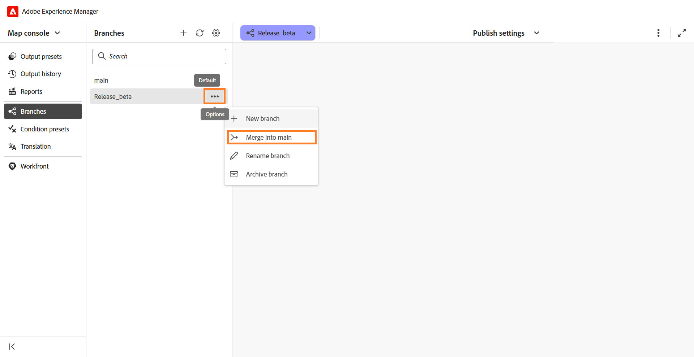

# Combinar una rama en la principal

En Experience Manager Guides, puede combinar cambios de una rama de un mapa DITA en la rama `main`. La combinación le permite incorporar actualizaciones de documentación completadas en `main` sin copiar manualmente los cambios en `main`.

Por ejemplo, considere un mapa DITA denominado `install-the-lift.ditamap` con una rama denominada `Release 2`. Los autores pueden actualizar las instrucciones de instalación en esta rama mientras la documentación existente permanezca sin cambios en `main`.

Una vez que las actualizaciones estén listas, los autores pueden combinar los cambios de `Release 2` en `main`.

## Comprender la combinación de ramas

La combinación trae cambios de una rama seleccionada de un mapa DITA a la rama `main`.

- **Rama de Source:** La rama que contiene los cambios que desea combinar.
- **Rama de destino:** La rama predeterminada (`main`) en la que se combinarán los cambios.

Si se ha modificado la misma parte de un tema o mapa en ambas ramas, pueden producirse conflictos de combinación que requieran resolución.

## Combinar una rama

Puede combinar los cambios de una rama seleccionada de un mapa DITA en `main`.

Para combinar una rama, realice los siguientes pasos:

1. Abra el mapa DITA necesario en la consola Mapa.
2. Vaya a la ficha **Ramas**.
3. Busque la rama que contiene los cambios que desea combinar.
4. Abra el menú **Opciones** de la rama y seleccione **Combinar en principal**.

   

   Se crea una solicitud de combinación para la rama seleccionada. Le permite revisar los cambios y resolver cualquier conflicto antes de combinarlos en `main`.

   

5. Seleccione la solicitud de combinación.

   La solicitud de combinación se abre en la vista **Combinar rama**. Revise los cambios y resuelva los conflictos, si es necesario.
6. Complete la combinación.

   Revise los cambios y resuelva los conflictos, si es necesario. Para obtener más información, vea [Resolver conflictos de combinación](#resolve-merge-conflicts).

   Una vez resueltos todos los conflictos, seleccione **Combinar todos** para combinar los cambios en `main`.

   Los cambios se combinan en la rama `main`.

## Resolver conflictos de combinación

Se produce un conflicto de combinación cuando se ha modificado el mismo contenido tanto en `main` como en la rama que se está combinando. Debe resolver todos los conflictos antes de combinar los cambios en `main`.

Cuando abre una solicitud de combinación, se muestran las siguientes secciones en la vista **Combinar rama**:

- **Conflictos:** Enumera los archivos que requieren resolución de conflictos.
- **Limpiar actualizaciones:** Muestra los archivos que se pueden combinar sin resolver conflictos.

Para los archivos con conflictos, se muestra la vista **Combinar rama**.

La vista **Combinar bifurcación** contiene los siguientes paneles:

- **Panel izquierdo (principal):** Muestra el contenido de la rama predeterminada (`main`).
- **Panel central (combinado):** Muestra el contenido combinado, donde puede aceptar cambios de cualquiera de las ramas o editar el contenido directamente.
- **Panel derecho (rama seleccionada):** Muestra el contenido de la rama que se está combinando en `main`.

Las diferencias se resaltan en los paneles izquierdo y derecho en función del contenido del panel **Combinado**:

- **Rojo (-):** Indica contenido presente en el panel **Combinado** que difiere del contenido en el panel izquierdo o derecho correspondiente.
- **Verde (+):** Indica contenido presente en el panel izquierdo o derecho que no está incluido en el panel **Combinado**.

Inicialmente, el panel **Combinado** contiene el mismo contenido que `main`, por lo que las diferencias se resaltan en el panel derecho. Una vez que acepte cambios de la rama seleccionada, el panel izquierdo mostrará diferencias en comparación con el panel **Combinado** actualizado.

Realice los siguientes pasos para resolver los conflictos de combinación:

1. En la sección **Conflictos**, seleccione el archivo que contiene conflictos.

   >[!NOTE]
   >
   > Los archivos enumerados en **Actualizaciones limpias** contienen cambios realizados solamente en la rama seleccionada y, por lo tanto, no requieren la resolución de conflictos.

2. Revise las diferencias resaltadas en la vista **Combinar bifurcación** y resuelva los conflictos mediante los controles de combinación.

   La casilla de verificación situada junto a un conflicto en el panel derecho determina cómo se agrega el contenido de la rama seleccionada al panel **Combinado**:

   - **Seleccionado (predeterminado):** Reemplaza el contenido coincidente del panel **Combinado** con el contenido de rama seleccionado.
   - **Borrado:** Agrega el contenido de la rama seleccionada junto con el contenido existente en el panel **Combinado** sin reemplazarlo.

   Puede resolver conflictos mediante las siguientes opciones:

   - Si desea utilizar los cambios de la rama seleccionada, mantenga seleccionada la casilla de verificación para el conflicto y, a continuación, seleccione el control de flecha apuntando hacia la izquierda (`<<<`) correspondiente. El contenido de la rama seleccionada reemplaza el contenido conflictivo en el panel **Combinado**.

     

   - Si desea conservar el contenido de ambas ramas, desactive la casilla de verificación del conflicto y, a continuación, seleccione el control de flecha hacia la izquierda (`<<<`). Esto agrega el contenido de la rama seleccionada al panel **Combinado** sin reemplazar el contenido que ya está presente en ese panel.

     

   - Si ha aceptado cambios de la rama seleccionada y desea restaurar el contenido correspondiente de `main`, seleccione el control de flecha hacia la derecha (`>>>`) en el panel izquierdo. Esto reemplaza el contenido seleccionado en el panel **Combinado** con la versión de `main`.

   >[!TIP]
   >
   > Pase el ratón sobre un control de flecha para ver cómo afectará al panel **Combinado** la aceptación del cambio seleccionado.

3. Después de revisar el contenido combinado, también puede utilizar una de las siguientes opciones para aceptar todo el contenido de cualquiera de las ramas:

   - **Aceptar principal:** Reemplaza el contenido del panel **Combinado** del archivo seleccionado con la versión de `main`.
   - **Aceptar [nombre de rama]:** Reemplaza el contenido del panel **Combinado** del archivo seleccionado con la versión de la rama seleccionada.

   >[!NOTE]
   >
   > Al seleccionar cualquiera de las opciones, se reemplaza todo el contenido del **panel combinado** para el archivo seleccionado, incluidos los cambios que haya realizado manualmente al resolver conflictos.

   También puede revisar o editar el contenido directamente en el panel **Combinado** y seleccionar **Marcar resuelto** para conservar el contenido combinado.

4. Revise el contenido final en el panel **Combinado** y seleccione **Marcar resuelto** para marcar el archivo como resuelto.

5. Repita los pasos para todos los archivos enumerados en **Conflictos**.

   Una vez resueltos todos los conflictos, estará disponible la opción **Combinar todo**.

6. Seleccione **Combinar todo** para combinar los archivos resueltos y las actualizaciones limpias en `main`.

   >[!NOTE]
   > 
   > La opción **Combinar todo** permanece deshabilitada hasta que se resuelvan todos los conflictos.

   Los cambios resueltos se combinarán en `main`. Las combinaciones completadas no se pueden deshacer. Sin embargo, puede crear una nueva solicitud de combinación para fusionar los cambios posteriores en main.

## Administración de una solicitud de combinación

Puede administrar las solicitudes de combinación existentes mediante el menú contextual.

Para administrar una solicitud de combinación, abra su menú contextual y seleccione una de las siguientes opciones:

- **Vista previa:** Muestra los cambios en la solicitud de combinación sin combinarlos.
- **Ver registro:** Ver el registro asociado con la solicitud de combinación.
- **Eliminar:** Eliminar la solicitud de combinación. La rama y sus cambios no se ven afectados.
- **Ver informe:** Ver el informe de combinación después de que la rama se haya combinado en `main`.